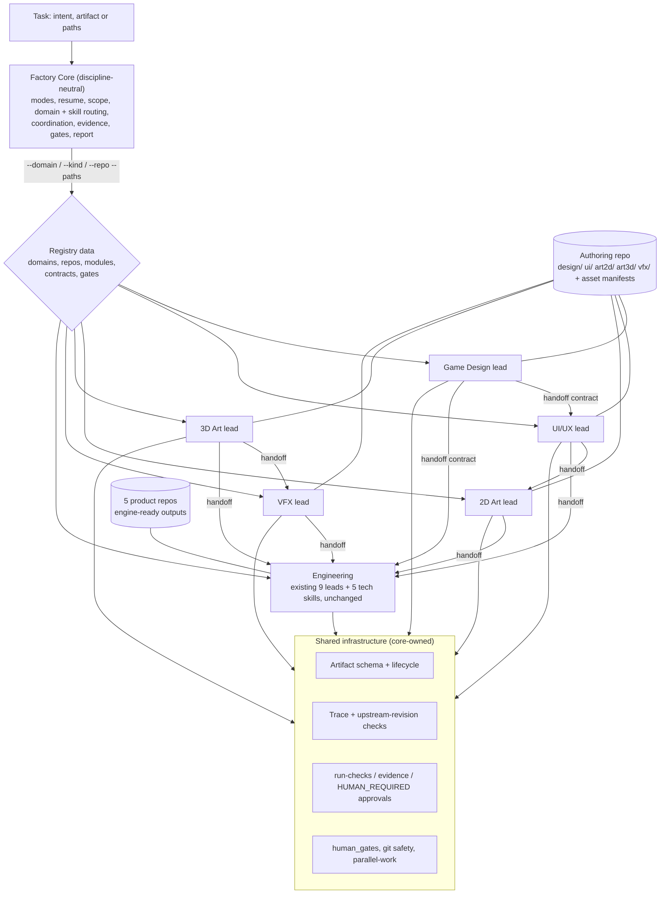

# rpg-factory as a modular multi-discipline game development factory

**Status:** proposed architecture plan. Nothing in this document is implemented. Each migration phase in
section 11 is a separate, separately approved change.

**Baseline:** `origin/main` @ `0bbe51a` (runtime release `v1.1.0` @ `d57be0b` plus 42 unreleased commits).
Code is cited as `path:line` at `0bbe51a`. Documents are cited by section.

**Decisions already taken by the maintainer (2026-10-29):**

1. **Game Design is a native domain of rpg-factory, with zero required dependency on game-ai-workflows.**
   - It owns GDDs, feature specifications, design decisions, the feature lifecycle and traceability through
     implementation, test, review and release.
   - The domain must work when game-ai-workflows is absent, and must serve Claude, Codex and other agents
     through rpg-factory's own contracts.
   - The `no-feature-registry` rule and the plugin-boundary lint change narrowly and on the record. The
     protection against unauthorized feature registries stays in force for every other domain.
2. **Artifacts live in a hybrid home.**
   - Engine-ready outputs stay in the existing product repos.
   - Authoring artifacts live in one new git repo registered in `registry.json` `repos`.
   - External sources (Figma files, DCC files) are referenced by manifest entries, never by routed paths.
3. **Architecture documents live in `docs/architecture/`**, with Mermaid diagrams. README and SKILL files keep
   their ASCII diagrams, because agents read them as raw text.

---

## 1. Executive summary and goals

rpg-factory today is an **engineering factory**. It routes repo-relative file paths in five product git repos
(server, client, netcode, unitydots, uitoolkit) to 14 skills: 9 leads and 5 reference ("tech") skills. Every
task must already be a file in one of those repos. Nothing models a discipline, an artifact that is not code,
or a handoff between disciplines.

This plan adds a **discipline (domain) layer** without rewriting what works. It covers six domains: Game
Design, UI/UX, 2D Art, 3D Art, VFX and Engineering.

- **The core stays discipline-neutral.** It owns modes, resume, scope, routing mechanics, coordination,
  evidence, gates and the report. Engineering-specific prose moves out of the core.
- **Every domain is data in the registry.** Each declares its lead skill, its artifact kinds, its repos and
  paths, its quality gates and its handoffs. The core reads that data and never encodes a discipline.
- **Engineering keeps every current behaviour.** The 14 skills, routing precedence, commands, hooks, modes and
  evidence keys don't change. Proof: identical routing output on every existing scenario and on history
  replay.
- **One shared artifact contract** (schema + lifecycle + trace + approvals) serves design documents, UI
  specifications, asset manifests and VFX specifications. Non-automatable results stay explicit as
  `HUMAN_REQUIRED`.
- **The change is incremental.** Phases P0-P6 build the foundation. P7+ adds each discipline under its own
  plan.

## 2. Current-state architecture (verified)

| Layer | Implementation | Observation |
|---|---|---|
| Orchestration | `skills/factory-core/SKILL.md` (160 lines; the lint cap is 160) | Modes, the 12-step workflow, validation states and the report are neutral. The description, the "Skills" table and the obligations (`.meta`, version bump) are engineering-specific |
| Shared references | `skills/factory-core/references/` | Mixed (see below) |
| Registry | `registry.json` (`schema_version` 3); `docs/registry.schema.json` allows unknown keys | Flat `skills{}` (`kind` ∈ core/repo/cross-repo/tech, unique `order`), `modules[]` (`skills[0]` = primary owner), `contracts[]` (source/copies/driver/gate), `repos{}` (5 git checkouts), `human_gates[]`, `global_rules[]` |
| Routing | `scripts/lib/resolve.jq`; `scripts/lib/context.py`; `scripts/factory-context.sh` | Path → longest-prefix module → lead class 0-3 → `order` |
| Session/hooks | `scripts/factory_session.py`, `scripts/git-guard.py`, `scripts/file-guard.py` | Advisory only. The Skill hook switches only on `kind == tech` plus `used_by` |
| Validation | `scripts/run-checks.py`, `scripts/lib/evidence.py` | Checks are bash commands run in a repo checkout. Evidence is keyed by tree identity. `HUMAN_REQUIRED` already exists (`run-checks.py:489`, `:632`) |
| Status | `scripts/factory-status.py` | Hard-coded wire-rollout and package logic for server/netcode/client |
| Skill authoring | `scripts/new-skill.py`, `scripts/skill-touchpoints.py`, `tests/skills-lint.sh`, `scripts/checks/skill-citations.py` | Keyed on `kind`. Assumes the flat `skills/<name>/` layout (`.claude-plugin/plugin.json` `"skills": "./skills/"`) |
| QA harness | `testlab/` | Outside the registry: no module, check, routing or owner. Only `skills/measure/references/legs.md` points to it |

The mixed shared references:
- `validation.md`: "Evidence per tool", "Environment notes (WSL)" and "CI coverage facts" are Go/.NET/Unity/CI
  specific. "Running checks", "Tiers" and "Result states" are neutral.
- `git-safety.md` "Rules": per-repo branch defaults, generator commands (protoc, golden vectors, UXML codegen,
  DOTS Sample) and submodule rules.
- `repos.md`: entirely workspace-specific.

Routing in detail:
- Only a `(repo key, repo-relative path in a git work tree)` pair is routable: `scripts/lib/context.py:285`
  returns "not a git work tree".
- Without `--repo`, every registry repo is examined (`context.py:548`).
- `AMBIGUOUS` (`resolve.jq:156`) can't occur, because `check-registry.sh:82` rejects duplicate `order`.

## 3. Structural problems and their impact

| # | Problem | Evidence | Impact |
|---|---|---|---|
| P-a | Routing only starts from file paths in the 5 product repos | `resolve.jq` input `$files`; `context.py:285` | Design, UI, art and VFX tasks can't be routed. An intent-only task ("design a crafting system") has no entry point |
| P-b | Core prose carries engineering knowledge | factory-core description and "Skills" table; `validation.md` "Evidence per tool"; `git-safety.md` "Rules" | New domains would inherit Go/.NET/Unity assumptions; the core can't stay neutral |
| P-c | Policy forbids design ownership | `registry.json` `global_rules` `no-feature-registry` (`:326`), `phase-plumbing-only` (`:291`); `tests/skills-lint.sh:170-175` | Conflicts with decision 1. Must change narrowly |
| P-d | No ownership model above modules | `skills.<name>.kind` mixes role (lead vs reference) with scope (repo vs cross-repo) | Domains can't be declared, enforced or queried |
| P-e | No artifact or handoff contract outside code | contracts model byte copies and pins only | No traceability from design to implementation, test and release; no revalidation when an upstream design changes |
| P-f | English-only is policy, not enforced | `global_rules` `english-only`; no lint | Multi-discipline content raises the risk of non-English docs |
| P-g | No home for architecture documents or ADRs | `docs/` holds only `registry.schema.json` | Decisions like this one have nowhere canonical to live |

## 4. Target architecture



**Responsibility boundaries:**
- **Factory Core** owns:
  - the task lifecycle and execution modes;
  - resume and workspace-state inspection;
  - scope and ownership resolution from registry data;
  - domain and skill routing mechanics;
  - multi-domain coordination (dependency graph from handoff contracts);
  - parallel-work rules;
  - the shared artifact, validation and evidence contracts;
  - review and report templates;
  - safety, approval and release policies;
  - skill registration and discovery.

  It owns no discipline knowledge.
- **A domain** owns its artifact kinds, its authoring paths, its quality gates (as data), its lead skill and
  its reference skills.
- **Engineering** owns everything that exists today, unchanged.

## 5. Domain ownership and skill classification

| Domain | Responsibility | Inputs → outputs | Routing entry | Allowed handoffs |
|---|---|---|---|---|
| Game Design | Concepts, mechanics, loops, progression, balance, systems, design docs, feature lifecycle, traceability | intent → GDD, feature spec with acceptance criteria, design decision record | `--domain design`; paths under the authoring repo's `design/` | UI/UX, Engineering, 2D/3D Art, VFX |
| UI/UX | Flows, information architecture, interaction design, usability, accessibility, interface specs | feature spec → flow/IA/interaction specs, accessibility criteria | `--domain ui`; `ui/` | 2D Art; Engineering (`client-integration` implements) |
| 2D Art | Sprites, illustrations, textures, 2D animation, visual consistency, delivery contract | UI spec or art brief → 2D asset manifest entries + delivered files | `--domain art2d`; `art2d/` | Engineering (import) |
| 3D Art | Modeling, materials, UVs, rigging, animation, optimization, engine-ready delivery | art brief → 3D asset manifest entries (models, materials, rigs, LODs) | `--domain art3d`; `art3d/` | VFX; Engineering |
| VFX | Effect design, implementation workflow, readability, performance budgets, effect validation | feature spec + 2D/3D references → effect specs and budgets, effect assets | `--domain vfx`; `vfx/` | Engineering |
| Engineering | Programming, infrastructure, tests, packages, networking, deployment | specs + assets → code, packages, deploys, tests | `--repo/--paths` (unchanged) | none (implements) |

**Skill classes** (an optional `role` field, derived from `kind` when absent):

| Class | Today's `kind` | Meaning | Can be a task owner? |
|---|---|---|---|
| orchestrator | `core` | factory-core only | coordinates only |
| implementer (domain lead or repo lead) | `repo`, `cross-repo` | Owns modules or contracts; runs a workflow | yes |
| reference | `tech` | Explains how a technology behaves | **never**. Enforced today by `resolve.jq:151-155`, routing property P7 and the Skill hook |

Engine-ready assets inside the client repo stay owned by `client-integration` (module `client.unity-assets`,
gate `unity-asset-edit`) until a discipline plan moves that ownership explicitly.

## 6. Registry and routing design

### 6.1 Flat registry with domain metadata (recommended) vs hierarchical registry

| Consumer | Flat + `domains{}` | Hierarchical registry |
|---|---|---|
| `scripts/lib/resolve.jq` (`$reg.skills[$s]` lookups, module and contract scans) | unchanged; one additive output field | rewrite every lookup |
| `scripts/check-registry.sh` (kind enum, unique `order`, fallback per repo) | about 8 new rules | rewrite |
| `scripts/new-skill.py` (kind/order allocation) | optional `--domain` | rewrite |
| `scripts/skill-touchpoints.py`, `tests/skills-lint.sh` (kind-based sections and counts) | unchanged | rewrite |
| `scripts/factory_session.py` (tech gating), `context.py` `--explain` | unchanged | rewrite |
| `docs/registry.schema.json` | unknown keys already allowed: no version bump | `schema_version` 4 |
| Claude Code skill discovery (`"skills": "./skills/"`) | flat names kept | nesting would rename or hide skills (not verified; avoided either way) |

**Recommendation: keep the registry flat and add a `domains{}` section, plus optional `domain` and `role`
fields** on skills, modules and contracts. The default `domain` is `engineering`, so every existing entry stays
valid as-is.

```json
"domains": {
  "engineering": {
    "summary": "Server, client, netcode and package code, infrastructure and tests.",
    "status": "active",
    "lead": null,
    "repos": ["server", "client", "netcode", "unitydots", "uitoolkit"],
    "artifact_kinds": [],
    "quality_gates": [],
    "handoffs": [],
    "may_own_feature_state": false
  },
  "design": {
    "summary": "Game design: GDDs, feature specs, design decisions, feature lifecycle and traceability.",
    "status": "planned",
    "lead": "design-lead",
    "repos": ["authoring"],
    "artifact_kinds": ["gdd", "feature-spec", "design-decision"],
    "quality_gates": ["artifact-lint", "artifact-trace"],
    "human_gates": ["gameplay-rules"],
    "approvers": [],
    "handoffs": ["feature-spec-to-impl"],
    "may_own_feature_state": true
  }
}
```

- `lead: null` means module ownership routes the domain. That is how Engineering keeps today's precedence.
- `kind` keeps its enum. It is checked in `check-registry.sh`, `new-skill.py`, `skill-touchpoints.py` and
  `skills-lint.sh`. New domain leads use `kind: repo`, because they own modules in the authoring repo.
- New skills keep the flat layout with a domain prefix (`design-*`, `ui-*`, `art2d-*`, `art3d-*`, `vfx-*`). No
  existing skill is renamed.

New `check-registry.sh` rules:
- every `domain` value names a `domains` entry;
- a domain lead is a skill of that domain;
- domain repos exist in `repos`;
- `quality_gates` and `handoffs` ids resolve;
- the feature-state rule from section 8.3.

### 6.2 Routing

| Task shape | Mechanism | Change |
|---|---|---|
| File paths in a product repo | Existing algorithm | Output gains one field, `domain` |
| Artifact in the authoring repo | The authoring repo is a normal registry repo with per-domain modules (`authoring.design-*`, `authoring.ui-*`, …, plus `authoring.root` fallback); longest-prefix routing applies | Data only |
| Intent only, no paths yet | New `--domain <id>` and `--kind <artifact-kind>` on `context.py` / `factory-context.sh`; the result is `domains[id].lead` plus repo, gates and artifact kinds | New flags; no keyword inference |
| Domain unclear | factory-core asks once; `--lead` stays the validated override (existing) | Skill text |
| Two domain leads claim one task | `AMBIGUOUS`, reachable only across domains; the user chooses | Engineering precedence untouched |

### 6.3 Multi-discipline orchestration

- **Detect.** A task spans domains when its artifacts span domains, or when the lead's artifact has handoff
  contracts to another domain.
- **Lead.** One lead per artifact: its owning domain's lead. factory-core coordinates the graph. There is no
  new orchestrator agent.
- **Dependency graph.** Built from data: `domains.*.handoffs` name `contracts[]`, where `source` is the
  upstream artifact path and `copies` are the downstream artifact or code paths.
  - The existing contract resolution (`resolve.jq:53-66`) already reports the other ends of a touched source
    as legs or follow-ups.
- **Parallel work.** Follows `skills/factory-core/references/parallel-work.md`: one worktree per workstream,
  QA and review on recorded candidate commits, and the lead integrates.
- **Conflicts.** The stricter rule wins (skill contract, "Composition"). Ownership disputes are settled by
  registry ownership, never by an agent.
- **Revalidation.** A downstream artifact records `upstream[].rev`, the git blob SHA of the upstream file. The
  trace check fails with `upstream-changed` when the upstream moves. Evidence `STALE` keeps its existing
  meaning: the tree identity changed.
- **Completion.** Every artifact in the graph has the status its contract requires, every acceptance criterion
  is traced, and the run-checks table has no FAIL, NOT_RUN or STALE.

```mermaid
sequenceDiagram
  participant C as Factory Core
  participant D as Game Design lead
  participant U as UI/UX lead
  participant E as Engineering leads
  C->>D: route --domain design (feature-spec)
  D->>D: draft spec, acceptance criteria, numbers TBD
  D-->>C: spec status review; gameplay-rules approval needed (HUMAN_REQUIRED)
  C->>U: handoff feature-spec -> ui-spec (upstream rev recorded)
  C->>E: handoff feature-spec -> implementation (paths routed as today)
  E-->>C: trace entries (impl/test commit SHAs per AC)
  C->>C: artifact-trace: all AC traced, upstream revs current -> verified
```

## 7. Shared contracts and the handoff model

### 7.1 Artifact contract

- **Format.** Markdown with YAML front matter, or a JSON manifest entry for assets.
- **Schema.** `docs/artifact.schema.json` in rpg-factory.

```yaml
id: FS-crafting-001            # unique in the authoring repo
kind: feature-spec             # one of domains.*.artifact_kinds
domain: design                 # owning domain
status: draft                  # per-kind lifecycle
title: Crafting
upstream:   [{id: GDD-core-001, rev: <git blob sha>}]
acceptance: [{id: AC1, text: "...", verify: test}]      # test | review | measure
trace:      [{repo: server, ref: <commit sha>, kind: impl, ac: [AC1]}]   # impl | test | release
approvals:  [{gate: gameplay-rules, by: <name>, date: <iso>, rev: <git blob sha>}]
```

Asset manifest entries add:
- `source_uri` (Figma, DCC file);
- `source_rev` or `hash`;
- `license`;
- `provenance` (authored, library, generated);
- `delivery` (target path in a product repo).

### 7.2 Shared checks

The new plugin scripts live in `scripts/checks/`. Each is declared as an ordinary registry check on an
authoring-repo module, so `run-checks.py` and `lib/evidence.py` work unchanged.

| Check | Verifies |
|---|---|
| `artifact-lint.py` | Schema, unique ids, legal status transitions against `HEAD~` |
| `artifact-trace.py` | Upstream revisions current; trace SHAs exist (`git cat-file -e` in the registered repo); acceptance-criteria coverage required by the status |
| `asset-manifest.py` | Required fields, license and provenance present, `delivery` path inside a registered repo |

- Domain quality gates are only check ids listed in `domains.*.quality_gates`. The core reads data.
- A later discipline gate (for example a VFX budget check) is a new check script plus one registry entry. The
  core doesn't change.

### 7.3 Outputs that tests can't prove

- A review or approval is an `approvals[]` record bound to the artifact's blob SHA. Editing the artifact makes
  the approval stale.
- A missing or stale approval is an external-tier check that grades **HUMAN_REQUIRED**. That state already
  means "a human or an external system has to act" (`run-checks.py:489`).
- No new result state is introduced. A visual review (for example a screenshot against a frame) is recorded
  the same way, with its evidence path.
- **Approval trust.** An `approvals[]` entry is text in the artifact, so anyone who can edit the artifact
  could add one. Agents never write approval records. A record counts as an approval only when all three
  hold:
  - the commit that introduced it is authored by an identity listed in a registry allowlist
    (`domains.<id>.approvers`: git author emails);
  - that commit reached the authoring repo's protected default branch through a reviewed pull request;
  - the commit carries no agent co-author trailer.

  `artifact-trace.py` checks the first and third conditions from git history (`git log` on the line that
  introduced the record). The second is a repository setting (branch protection) and is reported, not
  verified. Records that fail these checks grade **HUMAN_REQUIRED** with the reason. Until the authoring repo
  and its branch protection exist, every approval is advisory.

## 8. Game Design as a native domain

### 8.1 Artifacts and lifecycles

| Kind | Location (authoring repo) | Lifecycle |
|---|---|---|
| `gdd` | `design/gdd/` | `draft → approved → superseded` |
| `feature-spec` | `design/features/` | `draft → review → approved → in-implementation → verified → released`, plus `deprecated` from any state |
| `design-decision` | `design/decisions/` | `proposed → accepted or rejected → superseded` |

Feature-spec transition rules:
- **`approved`** needs a `gameplay-rules` approval on the current revision.
- **`verified`** needs every acceptance criterion traced (impl + test for `verify: test`).
- **`released`** needs a release trace entry: a tag in the product repo.
- **Going backwards** is allowed only to `draft`, and clears approvals.

### 8.2 Gameplay rules and approvals

- The design lead drafts structure and options. Numbers are `TBD` or clearly labelled proposals.
- Only a human approval record makes a value binding.
- The `gameplay-rules` human gate is unchanged and is attached to the design modules.

### 8.3 Narrow policy change (proposed for phase P5; the exact wording needs approval)

- **`no-feature-registry`.** Only domains with `may_own_feature_state: true` (Design) create or change GDD and
  feature state, and only in the authoring repo.
  - `.ai/`, `docs/registry/` and `docs/features/` in product repos stay forbidden for every domain.
  - game-ai-workflows is an optional, independent peer: never a dependency, never a source of truth.
- **`phase-plumbing-only`.** Add a clause: recording human-approved values in an approved design artifact is
  allowed. Inventing values stays forbidden.
- **`tests/skills-lint.sh:170-175`.**
  - The web-game-factory boundary stays.
  - The requirement that factory-core hand design work to game-ai-workflows is removed.
  - The GDD/feature-registry claim check exempts only skills whose domain has `may_own_feature_state: true`.
- **New `check-registry.sh` rule.** A module outside a feature-state domain must not own a `.ai/`,
  `docs/registry/` or `docs/features/` path.

### 8.4 Standalone guarantee

- There is no runtime reference to game-ai-workflows in scripts, hooks or skills. A test greps for it.
- All checks are plain CLI commands with no Claude-only hook dependency, so Codex and other agents can run
  them.

## 9. Documentation architecture and English-only policy

| Category | Canonical source |
|---|---|
| Factory-wide overview | `README.md` |
| Domain architecture, ownership, routing, ADRs | `docs/architecture/` (`README.md`, this plan, `domains.md`, `artifacts.md`, `routing.md`, `adr/NNNN-<title>.md`) |
| Machine contracts | `registry.json`, `docs/registry.schema.json`, `docs/artifact.schema.json` |
| Skill instructions | `skills/<name>/SKILL.md` (≤160 lines) + at most 3 references (factory-core is exempt) |
| Shared policy (git, validation, report, parallel work, skill contract) | `skills/factory-core/references/` (neutral parts only after P3) |
| Engineering reference (tool evidence, WSL, CI facts, generators, branch defaults) | one engineering reference split out of core in P3 |
| Testing and maintenance | `.claude/CLAUDE.md` "Commands" and the `tests/` file headers |

Rules:
- **One canonical copy per fact.** Other places link to it. The existing shingle check in `skills-lint.sh` and
  the single-copy pattern used for `parallel-work.md` extend to `docs/architecture/`.
- **Diagrams.** Mermaid in `docs/architecture/` only.
- **English-only enforcement.** A new `scripts/checks/english-only.py`, called from `skills-lint.sh`, covers
  skills, references, `docs/`, README, CHANGELOG, `.claude/CLAUDE.md`, commands and registry strings.
  - It flags letters from non-Latin scripts, and lines where 5% or more of letters are non-ASCII Latin. The
    5% rule catches Vietnamese and other diacritic-heavy text.
  - Symbols and arrows are allowed, plus an explicit `path:line` allowlist.
  - It starts report-only, and fails once the baseline is clean. Existing documents are not bulk-translated.

## 10. Compatibility with 1.1.0 and the unreleased commits

- **Unchanged:**
  - all 14 skills, their names and directories;
  - commands (`status`, `route`, `check`, `doctor`);
  - hooks and their advisory-only behaviour;
  - modes, human gates and evidence keys;
  - `factory-status.py`, which stays engineering-only.
- **Gains metadata only:** existing skills and modules (`domain` defaults to `engineering`).
- **Path assumptions that must be handled:**
  - `check-registry.sh` fails when a registered repo path is missing, and `context.py:548` snapshots every
    repo.
  - So the authoring repo needs `repos.<key>.optional: true`: skipped when absent, and excluded from the
    default snapshot until present.
  - Dogfood expectations must be re-checked when the snapshot gains a line.
- **Unreleased commits (`v1.1.0..0bbe51a`).**
  - Mostly testlab, plus `run-checks` worktree targeting (`--repo-path`, canonical-checkout guard), git
    environment isolation and citation refreshes. None changes routing, the schema, the session hook, the
    guards or the skill lint.
  - The CHANGELOG has repeated `### Fixed`/`### Added` headings under `[Unreleased]`, and testlab entries
    filed under the released `[1.1.0]`. Phase P0 fixes both before any architecture change.

## 11. Migration roadmap

Each phase is one pull request with its own approval, independent review and `tests/run-all.sh` = 0 failed.

| Phase | Scope (affected files) | Acceptance criteria (measurable) | Release |
|---|---|---|---|
| **P0 Baseline** | Review and adopt the 42 unreleased commits; fix the CHANGELOG headings and mis-filed `[1.1.0]` entries; record the baseline: run-all count, routing scenario count, `routing-properties` statistics, dogfood and eval results | run-all 0 failed; the `[1.1.0]` section equals the tagged text; baseline file committed | patch 1.1.1 (needs release authorization) |
| **P1 Architecture docs** | `docs/architecture/` (this plan, README, ADR-0001 "domains"); `english-only.py` report-only; README pointer | lint green; routing outputs unchanged | patch |
| **P2 Domain metadata** | `registry.json` `domains{engineering}` and optional `domain`/`role`; `docs/registry.schema.json`; `check-registry.sh` rules and fixtures; `resolve.jq` `domain` output field; `repos.*.optional` in `check-registry.sh` and `context.py` | routing output byte-identical except the new field across all `tests/routing.test.sh` scenarios and the 17 history replays; `routing-properties` statistics identical; new check-registry cases pass; dogfood 19/19 | minor |
| **P3 Core neutrality** | Move the engineering sections of `validation.md` ("Evidence per tool", "Environment notes (WSL)", "CI coverage facts"), the generator/branch parts of `git-safety.md` "Rules" and `repos.md` into an engineering reference; neutral factory-core description and "Skills" introduction | SKILL.md ≤160 lines; skills-lint, touchpoints and citations green; dogfood 19/19; eval results unchanged | patch |
| **P4 Shared artifact contract** | `docs/artifact.schema.json`; `artifact-lint.py`, `artifact-trace.py`, `asset-manifest.py`; `--domain`/`--kind` flags; fixture authoring repo | new `tests/artifacts.test.sh`: valid artifact PASS; illegal transition, stale upstream and unknown SHA FAIL; missing approval HUMAN_REQUIRED; engineering routing unchanged | minor |
| **P5 Game Design domain** | Register the authoring repo (optional) and design modules; `design-lead` skill via `new-skill.py`; policy and lint change (section 8.3); dogfood scenario and eval | new `tests/domains.test.sh`: standalone without game-ai-workflows (no runtime reference); a non-design skill claiming GDD still fails lint; a non-design module owning `docs/features/` fails check-registry; approval without the gate fails; engineering replay identical; checks pass without `CLAUDE_*` environment | minor |
| **P6 Cross-domain handoffs** | Handoff contracts feature-spec → server/client/ui spec; trace over product commit SHAs | fixture: editing an upstream spec fails the downstream trace with `upstream-changed`; completion rule evaluated end to end | minor |
| **P7+ Disciplines** | UI/UX, then 2D Art, 3D Art and VFX, each under its own discipline plan | same template as P5 | minor each |

**Rollback:**
- Every phase is additive and reverts as one PR.
- `domain` defaults to `engineering`, and optional repos are skipped when absent, so reverting a later phase
  leaves the earlier ones valid.
- Released tags are never moved.

## 12. Testing and acceptance

- **Preservation of current behaviour:**
  - `tests/routing.test.sh`: scenarios plus history replays.
  - `tests/routing-properties.test.py`: P1-P8 over the last 120 commits per repo.
  - The resolver expectations in `tests/run-all.sh`, plus `scripts/check-registry.sh` and `tests/skills-lint.sh`.
  - `tests/dogfood.sh`: 19 real-session scenarios, including mode and tech-skill gating.
  - Comparison method: a JSON dump of `routing.*` for every scenario before and after each phase, with a diff
    of zero (apart from the new `domain` field).
- **New behaviour:**
  - `tests/artifacts.test.sh` (P4) and `tests/domains.test.sh` (P5).
  - New `check-registry` fixtures (P2).
  - English-only fixtures (P1).
  - One new dogfood scenario per domain lead.
- **Not run for this plan:** no test proves the architecture. This document was validated only by the
  docs-only `tests/run-all.sh` run recorded in its pull request.

## 13. Risks, trade-offs, rollback and open decisions

**Risks:**
- An extra repo line changes snapshot output (dogfood expectations).
- The added `resolve.jq` field costs time on every route; measure it in P2.
- Status-transition checks rely on git history, so they are advisory after a history rewrite. That matches the
  "hooks never block" policy.
- Two plugins could claim the same GDD when game-ai-workflows is also installed.

**Trade-offs:**
- **One authoring repo, not one per domain.** It gives a single trace graph and less overhead, at the cost of
  weaker isolation between disciplines.
- **Flat registry.** No disruption, at the cost of a long `registry.json`.

**Open decisions for the maintainer:**
- **Authoring repo:** name and key (proposed key `authoring`, directory `game-authoring`) and its creation.
  Creating a GitHub repo is a `publish`/`shared-infra` action.
- **Global rule wording:** the exact `no-feature-registry` and `phase-plumbing-only` text.
- **P0 release:** whether P0 ships as 1.1.1.
- **Coexistence:** whether rpg-factory ignores `.ai/` entirely (recommended) or offers an optional importer.
- **Approvers:** who is on `domains.design.approvers`, and whether the authoring repo requires reviewed pull
  requests on its default branch (needed for approval trust, section 7.3).
- **Testlab:** whether it becomes a QA domain. It isn't one of the six requested.

**Not verified:**
- whether Claude Code discovers nested skill directories (the plan avoids nesting either way);
- whether `skill-touchpoints.py` needs a domain column for a non-engineering lead in the README tables.

## 14. Deferred to discipline-specific plans

- **Skill catalogs and workflows** for each domain (design, UI/UX, 2D, 3D, VFX).
- **Tooling:** art, image, modeling, animation and VFX tools and their dev-tool probes.
- **Ownership moves** of engine-ready client assets out of `client-integration`.
- **Domain-aware `factory-status`** view.
- **QA/testlab** as a domain.
- **Optional interoperability** with game-ai-workflows (import only, never a dependency).
