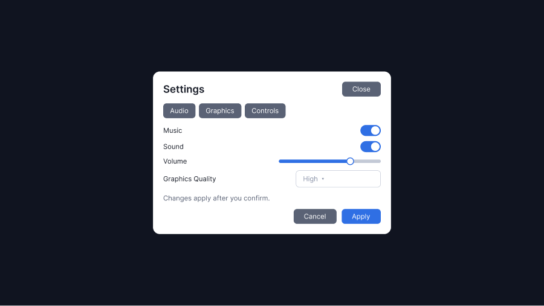
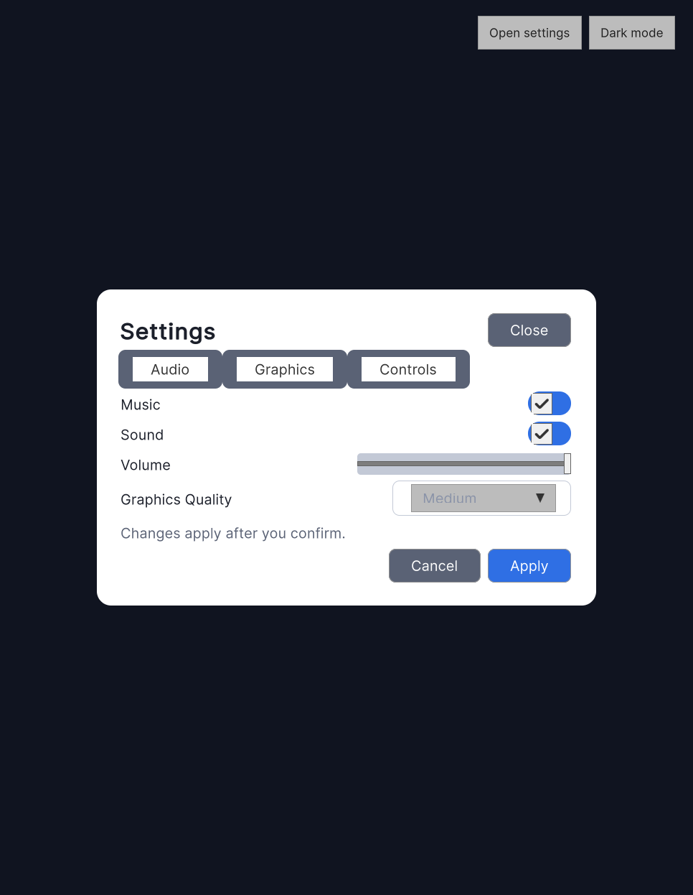
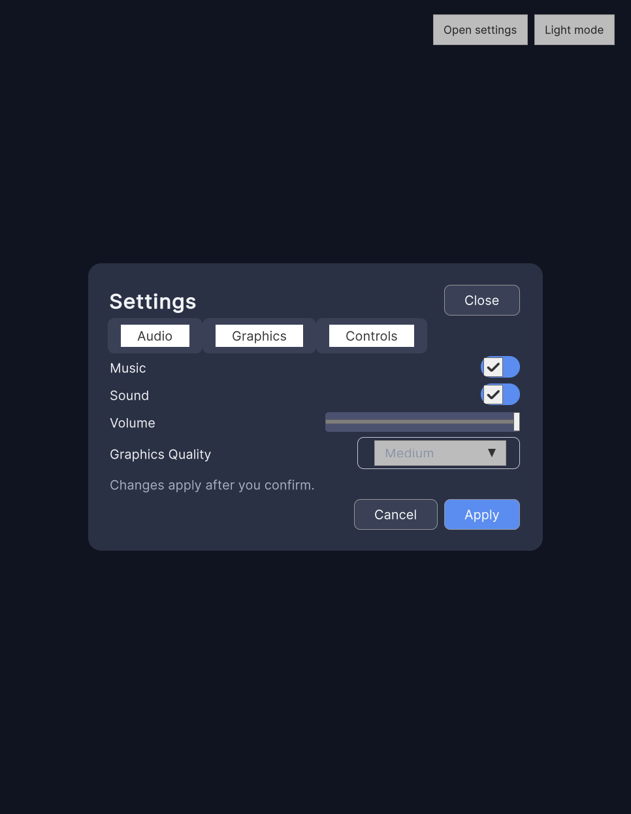
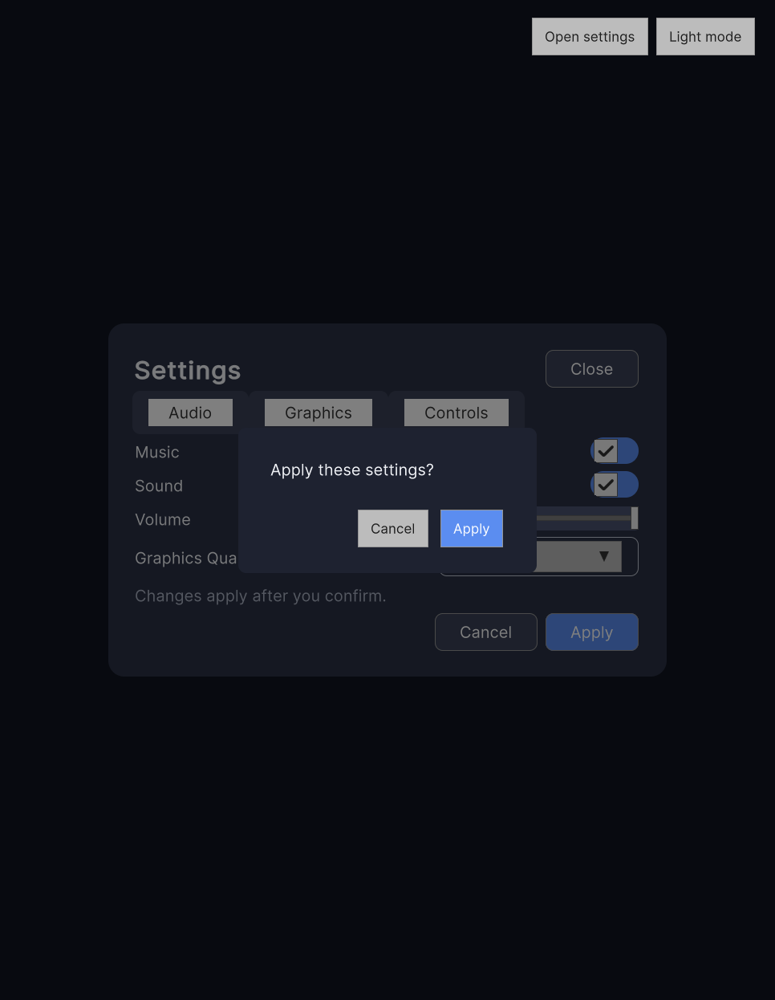

# Real Figma-to-Unity integration test: "Game Settings"

> **Status: RUN (2026-10-31, runs 1 and 2).** Run 1 imported and validated the frame. It exposed two plan defects,
> fixed in round 3: intent `figma-validate` instead of `figma-import`, and lead `unity-package` instead of
> `client-integration`. Run 2 went end to end: import, validation, integration, Play mode, and tests. Rows that are
> not verified say so (see "Not verified"). Every state below names its evidence file.

This procedure proves the rpg-factory UI path end to end on real tools: a Figma frame built to the
com.cuvara.uitoolkit 0.8 designer rule goes through Unity's official UI Toolkit Connector for Figma
(`com.unity.ui.figma` 0.3.0-exp.1) into a throwaway lab project, is validated, integrated with the package's
profile, token bridge, mapping preset and theme service, and shown in Play mode in light and dark.
The agent side is driven by the plugin (`/rpg-factory:ui-figma`, skills `ui-figma-import`, `ui-component-selection`,
`ui-toolkit-screen`, `ui-validation`) in a headless `claude -p` session.

It follows the package's own lab procedure (UIToolkit v0.8.0 `Documentation~/FIGMA-REAL-IMPORT.md` "Lab procedure"
and "Evidence checklist"). Nothing here touches the client repo or another project.

## Prerequisites (human)

| Item | Version or state |
|---|---|
| Unity | 6000.3.9f1 (the tested version) installed in Unity Hub |
| Figma | an account with edit access to a draft file; a paid plan for two variable modes (Free has one mode per collection) |
| Figma plugin | Community plugin **Unity UI Toolkit Connector** |
| .NET SDK | 10 (the validator CLI targets `net10.0`) |
| Python | 3.8 or later |
| Claude Code | logged in; this plugin checked out (the worktree under test) |

## 1. Figma test design: "Game Settings"

One frame, 390 x 844, named `GameSettings`, built to the designer rule (FIGMA-INTEGRATION.md "Supported and
unsupported Figma features"): **variables are bound only on component roots and on single-text `<Role>/Label`
components; plain layers keep literals; the screen root's fill is a literal.**

Variables (collection `Theme`, modes `Light` and `Dark`; COLOR and FLOAT only - STRING and BOOLEAN never import):

| Variable | Light | Dark |
|---|---|---|
| `Surface/Background` | `#F4F1EA` | `#14161A` |
| `Surface/Panel` | `#FFFFFF` | `#22262D` |
| `Text/Primary` | `#1B1D21` | `#F2F2F2` |
| `Text/Muted` | `#5E636B` | `#A3A9B3` |
| `Accent/Primary` | `#2F6FEB` | `#5B8DFF` |
| `Radius/Panel` | 12 | 12 |
| `Space/Padding` | 16 | 16 |

Components (each root binds its own variables; inner layers stay unbound):

| Component | Root binding | Contents | Expected Unity control |
|---|---|---|---|
| `Title/Label` | text colour `Text/Primary`, text style Title | one text layer | `ui:Label` (name convention) |
| `Body/Label` | text colour `Text/Muted`, text style Body | one text layer | `ui:Label` |
| `Panel` | fill `Surface/Panel`, radius `Radius/Panel`, padding `Space/Padding` | auto layout, vertical | `VisualElement` with a class |
| `Button` | fill `Accent/Primary`, radius | one text layer | `ui:Button` |
| `Toggle` | - | box + one text layer | `ui:Toggle` (record what the import produced) |
| `Slider` | - | track + handle | `ui:Slider` (record what the import produced) |
| `Dropdown` | fill `Surface/Panel` | one text layer + chevron icon | record the result; a near-miss name shows as `fact.NearMissNames` |
| `ConfirmDialog` | fill `Surface/Panel`, radius | `Title/Label`, `Body/Label`, two `Button` instances | design reference only: Unity uses the package's `ConfirmDialog.ShowAsync`, themed through the bridge |

Frame content, top to bottom, all auto layout without gap (gap is dropped on 6000.3; use padding):

1. Background: the frame root, literal fill `#F4F1EA` (expected: `FIG020` x1, accepted).
2. Header: `Title/Label` "Settings" and a close `Button` (icon "X" as a vector inside the component - becomes a PNG).
3. Section tabs: a tab container with tabs "Audio", "Graphics" (tabs outside their container show `fact.TabsOutsideTabView`).
4. `Panel` instance holding: `Toggle` "Music", `Toggle` "Sound", `Slider` "Volume", `Dropdown` "Graphics Quality".
5. Footer: `Button` "Apply" and `Button` "Cancel" (one component, used twice: the reusable-instance check).
6. A `ConfirmDialog` instance beside the frame (not inside it), for the visual reference.

Do not use: frame drop shadows, gradients, background blur, blend modes, grid layout, negative spacing, instance-level
variable overrides. Use a font that is in the lab project or record `fact.MissingFonts`. Rename the file to
`RpgFactory-GameSettings` before copying the link (the connector matches the file by the name slug in the link).

Capture: `Copy link to selection` on the frame (with `node-id=`) and a PNG export of the frame (`figma-frame.png`).

## 2. Lab project

The lab script takes a package **checkout** and writes `file:<abspath>` (`Tools~/FigmaLab/create-lab-project.py`,
`build_manifest`); it does not accept a git URL. Export the tag read-only, then create the lab:

`$UITOOLKIT` is a local clone of Cuvara/UIToolkit and `$SCRATCH` any empty scratch folder.

```bash
mkdir -p $SCRATCH/uitoolkit-v0.8.0
git -C $UITOOLKIT archive v0.8.0 | tar -x -C $SCRATCH/uitoolkit-v0.8.0
python3 $SCRATCH/uitoolkit-v0.8.0/Tools~/FigmaLab/create-lab-project.py $SCRATCH/project \
  --package $SCRATCH/uitoolkit-v0.8.0
```

To test the git pin instead, edit the lab's `Packages/manifest.json` afterwards to
`"com.cuvara.uitoolkit": "https://github.com/Cuvara/UIToolkit.git#v0.8.0"` and record which form was used.

Build the validator CLI once, outside any package folder (`dotnet run` in the package would write `obj/` and `bin/` there):

```bash
dotnet build $SCRATCH/uitoolkit-v0.8.0/Tools~/UxmlCodegenCli/UxmlCodegenCli.csproj -o $SCRATCH/cli
```

(The build writes `obj/` into the exported copy, never into the UIToolkit repo.)

Open the project in Unity 6000.3.9f1, wait for the first compile (no Console error), enable Allow Browser
Clients if the lab script asks, restart the Pipeline server, **Window > UI Toolkit > Connector for Figma design >
Copy token**, and paste it within 60 s into the Figma plugin's Settings tab, then **Connect to Unity**. In Edit >
Project Settings > UI Toolkit > Connector for Figma design, **Create mapping**.

## 3. Agent run

Run each command from the lab folder with this plugin checkout loaded. Record each session's stream to a file.

```bash
P=<this plugin checkout>; L=$SCRATCH/project; E=$SCRATCH/evidence; mkdir -p "$E"
python3 -B "$P/scripts/ui/figma_env.py" --project "$L" --json --probe-pipeline > "$E/01-figma-env.json"
cd "$L" && claude --plugin-dir "$P" -p "/rpg-factory:ui-figma import <frame link> into the Unity project $L, prefix rpg" \
  --output-format stream-json --verbose > "$E/02-session-import.jsonl"
cd "$L" && claude --plugin-dir "$P" -p "/rpg-factory:ui-review review the imported GameSettings screen in $L" \
  --output-format stream-json --verbose > "$E/03-session-review.jsonl"
```

Expected agent behaviour (graded from the stream): the UI plan lists `ui-figma-import`, `ui-component-selection`,
`ui-toolkit-screen`, `ui-validation` in that order and no other UI skill; factory-core runs first; the designer
preflight is reported before the import; figma_env runs; the import uses
`Tools~/FigmaImport/figma-import.py ... --validate --prefix rpg --json --cli dotnet $SCRATCH/cli/UxmlCodegenCli.dll`;
the agent asks before writing into the project; no UXML or USS is written by hand; the report names states with evidence.

Then, in the Editor (by the agent through the Unity MCP server when available, else by hand):

1. Assets > Create > Cuvara > UI Toolkit > Figma Profile: connector folder `Assets/Figma/RpgFactory-GameSettings`,
   prefix `rpg`, bridge folder `Assets/Game/UI/Theme`, screens folder `Assets/Game/UI/Screens`, mode sheets
   `light.uss`, `dark.uss`; map at least `--cuvara-color-surface`, `--cuvara-color-primary` and the text roles.
2. Tools > Cuvara > Figma > Apply Cuvara Mapping Preset; Tools > Cuvara > Figma > Regenerate Token Bridges.
3. Assets > Cuvara > Create Screen, Source **Existing UXML (e.g. Figma import)**, the imported `GameSettings.uxml`,
   output `Assets/Game/UI/Screens`.
4. A scene with a `RootUIDocument` (`themeOverrides` = `tokens.uss`, `cuvara-theme-bridge.uss`; `themeModeSheet` =
   `light.uss`), the screen registered with its `AssetKey`, `RegisterModeSheets(light, dark)` and `AttachScreen`.
5. Play mode: screenshot light; switch to dark; screenshot; open `ConfirmDialog.ShowAsync` from Apply; screenshot.
6. Run the package's EditMode tests in the lab (Test Runner, or batchmode with the human gate `unity-batch`).

## 4. Evidence to capture

Store everything under `$SCRATCH/evidence/` and list the paths in the Evidence table.

- `figma-frame.png` (Figma export) and the frame link (file key, node id).
- `01-figma-env.json` and the two session streams.
- The saved import result `Library/CuvaraFigma/last-import-RpgFactory-GameSettings.json` (copy) and the helper's stdout JSON.
- Validator JSON: `dotnet $SCRATCH/cli/UxmlCodegenCli.dll validate <lab>/Assets/Figma/RpgFactory-GameSettings --prefix rpg --json`.
- Figma Diagnostics window screenshot (versions, mapping, profile, token coverage, bridge freshness, last import result).
- Console log after import and after Play (no error expected; any warning listed).
- Play-mode screenshots: light, dark, dark with ConfirmDialog.
- Test results XML or Test Runner screenshot with counts.
- `git status` (or file times) of the lab after a second push: only connector files changed.

## Evidence

Provenance (the run host, not committed): evidence files are in `C:/tmp/rpgf-ui/evidence/run2/` unless the path is `images/`.
Transcripts: `C:/tmp/rpgf-ui/real/session-import.jsonl` (run 1) and `session-import2.jsonl` (run 2). Both runs used
the lab `C:/tmp/rpgf-ui-lab`, not the paths in section 3, and the prompt `/rpg-factory:ui-figma Import the Game Settings
screen from <frame link> into the Unity project C:/tmp/rpgf-ui-lab and integrate it ...`.

| Item | Value |
|---|---|
| Run dates | run 1: 2026-10-31 (result `savedAt` 01:46:25Z); run 2: 2026-10-31 |
| Unity version | `6000.3.9f1` |
| `com.unity.ui.figma` / `com.unity.pipeline` | `0.3.0-exp.1` / `0.9.1-exp.1`, Pipeline port 7800 |
| `com.cuvara.uitoolkit` | `0.8.0`, git `#v0.8.0` (`Library/PackageCache/com.cuvara.uitoolkit@99daab92fa6a`) |
| Figma plugin version | not recorded |
| Figma file / frame | design source `ueBJbugEygxaayXY564FjK` node `3:59`, created through the Figma MCP. Lab copy `fHYY12QeVytCKZr8WfGp2P` ("rpg-factory UI Skills Lab - Game Settings") node `3:59`, duplicated into the browser account because the MCP account and the browser account differ |



| # | Check | Result and evidence | State |
|---|---|---|---|
| 1 | figma_env | Unity, package, connector and Pipeline OK; port 7800 reachable (`--probe-pipeline`); figma-plugin HUMAN_REQUIRED (informational). Transcript run 1 | PASS |
| 2 | UI plan | run 1: `figma-validate`, lead `unity-package`, 2 skills: FAIL (fixed in round 3). Run 2: PLAN `figma-import`, lead `client-integration`, skills `ui-figma-import`, `ui-component-selection`, `ui-toolkit-screen`, `ui-validation` in order (`agent-report.md`) | PASS (run 2) |
| 3 | Preflight before import | Figma MCP calls on the lab copy failed with "you don't have edit access to this file" (both runs). No variable-binding preflight; the validator on the output stood in | HUMAN_REQUIRED |
| 4 | Import | run 1 `r-e91f7030`: `done`, 116 nodes, 0 templates, `ussErrors` false, 3437 ms, 5 files + `.figma-manifest.json`, no `images/`. Run 2 re-push `r-0173d530`: `done`, 116 nodes, files byte-identical to run 1 (`import-run.txt`, `pre-import-md5.txt`) | PASS |
| 5 | Validator | 0 errors, 7 warnings, 2 infos: FIG020 x7 (6 literal colours in `GameSettings.uss` + the root `background-color: #101420` inline), FIG021 x1, FIG031 x1 (31 inline-styled, 0 absolute); no FIG023 (`validator.json`). With a prefix, FIG010 x11 on top (`--prefix cuvara` in run 1; 18 warnings with `--prefix lab` in run 2): the connector prefix is empty. The spec expected FIG020 x1 | FAIL (non-blocking: 0 errors) |
| 6 | Connector facts | NearMissNames x14 (10 items stored), DiscardedLayers x4 (`Knob` x2, `Fill, Thumb`, `High ▾`), MissingFonts x1 (Inter), DroppedGap x11, MultiMode x2 (Light, Dark). No `TabsOutsideTabView` although the 3 tabs have no TabView parent | FAIL (ungrouped tabs not reported) |
| 7 | Hierarchy | `GameSettings.uxml` order: title, Close, 3 tabs, Music, Sound, Volume and Graphics Quality rows, note, Cancel, Apply, as in Figma. Checked in the UXML, not in the UI Toolkit Debugger | PASS |
| 8 | Control mapping | 3 `ui:Button`, 2 `ui:Toggle`, 1 `ui:Slider`, 1 `ui:DropdownField` (component `Dropdown`), 3 `ui:Tab` in a plain `ui:VisualElement` (no `ui:TabView`), 6 `ui:Label`; 0 `name` attributes | PASS |
| 9 | Reusable instance | 0 templates; the three buttons carry three classes (`button-close`, `button-primary`, `button-secondary`): the design used three Button components, not one used three times | FAIL (design deviation) |
| 10 | Tokens and bridge | `tokens.uss`, `light.uss`, `dark.uss` imported; bridge `Assets/Games/Lab/UI/Theme/cuvara-theme-bridge.uss`: 8 roles mapped, 12 `role-unmapped` infos, no unknown token, run 2 `wrote=False` (fresh). Mapping preset: `cuvara.mapping.no-asset`, 0 rows (`preset-bridge.txt`) | PASS (bridge); preset HUMAN_REQUIRED |
| 11 | ScreenCreator | `ScreenCreatorPlan.Build` (Popup, Existing UXML), run through Pipeline `script eval` (transcript run 2), produced the view and presenter, now `Assets/Games/Lab/UI/Screens/GameSettingsScreen.cs`; no UXML or USS written; connector files md5 10/10 unchanged (`agent-report.md`) | PASS |
| 12 | Play mode light | screen open (`top=Lab.UI.Screens.GameSettingsPresenter`), panel background `RGBA(1,1,1,1)`, 966x1246 (`playmode-state.txt`) | PASS |
| 13 | Play mode dark | panel background `RGBA(0.169,0.192,0.267,1)` after the mode switch, screen attached with `AttachScreen` (`playmode-state.txt`) | PASS |
| 14 | ConfirmDialog | the package `ConfirmDialog.ShowAsync` on Apply, themed dark (screenshot below); confirm and cancel both covered by the PlayMode test | PASS |
| 15 | Tests | lab EditMode 3/3 (`tests-editmode.json`), lab PlayMode 1/1 (`tests-playmode.json`: controls, Apply with confirm and cancel, layout bounds, light/dark resolved colour, Close). Negative control: with the layout fix off, the bounds assertion fails (`tests-playmode-control.json`: panel x 359.72, width 560.11, in a 777.39-wide layer). All tests in the lab Editor (Lead): EditMode 463/463 (package 460 + lab 3, `lead-tests-editmode-all.txt`), PlayMode 348/348 (package 347 + lab 1, `lead-tests-playmode-all.json`) | PASS |
| 16 | Re-push | run 2 re-push wrote the same bytes (md5 identical); bridge not rewritten (`wrote=False`). The screens did not exist before the re-push, so "screens untouched" was not tested | PASS (partial) |
| 17 | Console | 0 errors. 2 warnings in the buffer, both orphan `.meta` files from moving screenshots (`console-playmode.json`); the Editor counted 4 warnings, 2 not read | PASS |





### Not verified

- **Tabs:** the 3 `ui:Tab` have no `TabView`. They render as plain tab headers and switch nothing.
- **Discarded layers:** the toggle knob, slider fill and thumb, and dropdown arrow were discarded (`DiscardedLayers`), so these controls use Unity's default look, not the Figma design.
- **Spacing:** `DroppedGap` x11. Auto layout gaps are missing; no game-owned spacing sheet was added.
- **Font:** Inter is not in the project (`MissingFonts`). Text uses the default font.
- **Mapping preset:** not applied. It needs the connector mapping asset first (Project Settings > UI Toolkit > Connector for Figma design > Create mapping); `figma_env.py` reports it as `mapping-asset`.
- **Aspect ratio:** only one, 966x1246, was captured. The Figma frame root carries an inline 1280x720 size, which the view stretches at runtime.
- **Back, Escape and Cancel:** Back/Escape (`OnBackRequested`) and the Cancel button are implemented but not tested.
- **Music and Sound flags:** these are game-owned (`LabAudioSettings`), because `SettingsModel` has no such members. The mapping is a design decision. `SettingsModel` clamps `GraphicsQuality` to 0-3 while the project has 6 quality levels.
- **Figma MCP preflight:** unavailable on the browser account's copy.
- **Not exercised:** SafeArea emission, shadows, gradients, typed node-id bindings (G4).
- **Not run:** `run-checks.py` and UXML codegen drift; the lab is outside the registry.
