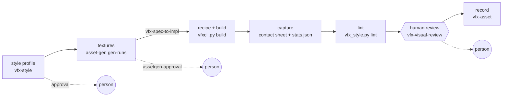

# VFX production chain

How one visual effect goes from an approved style profile to a reviewed delivery record, which repository owns each
part, and what stays with a person. This page is the overview; each fact has one canonical copy that it links to:

- Rules and steps of the lead: `skills/vfx/SKILL.md` and `skills/vfx/references/production-loop.md`.
- Technology of the engine leg: `skills/vfx-graph/SKILL.md` and its references (`recipe-format.md`, `capture.md`,
  `vfxgraph-review.md`).
- Domain rules, checks and gates: [VFX domain](domains/vfx.md).
- The plan engine: `scripts/vfx/vfx_plan.py` with its rules in `scripts/vfx/data/plan.json`
  (`/rpg-factory:vfx-plan`).
- Package behaviour: the UnityVFX checkout, `README.md`, `Documentation~/AUTHORING.md` and
  `Documentation~/CAPTURE.md`.

## The chain

`scripts/vfx/vfx_plan.py` reports the same chain as five steps (`style`, `textures`, `recipe`, `capture`, `record`;
the capture step includes the lint) and gives each a state (`DONE`, `IN_PROGRESS`, `TODO`, `NEEDS_APPROVAL`, `STALE`,
`FAIL`, `BLOCKED`). Work the first step that is not `DONE`.

| Step | What happens | Output | Tool or verb |
|---|---|---|---|
| 1. Style profile | The project's one binding `vfx-style` profile: palette and colour ramps per element, HDR bands per importance tier, phase timing ratios, texture conventions, budgets, the capture viewing conditions and the asset-gen style for textures. A person approves it. | `vfx/style/<profile>.md` | `scripts/vfx/vfx_style.py show` |
| 2. Textures | Effect textures are generated through `rpg-factory:asset-gen` with a vfx purpose (`vfx-flipbook`, `vfx-noise-tileable`, `vfx-trail`, `vfx-sprite`) and the profile's `assetgen_style`. A person approves each gen-run (gate `assetgen-approval`). | approved gen-runs in `assetgen/runs/`, cited in the spec's `sources` | handoff `assetgen-to-vfx` |
| 3. Recipe | The approved spec, profile and gen-run IDs go to the Engineering leg, which writes `<Name>.vfxrecipe.json` (`cuvara.vfx-recipe/1`), builds `<Name>.vfx` next to it and imports the textures. | `Effects/<Name>/` in UnityVFX | handoff `vfx-spec-to-impl`; `Tools~/vfxcli.py build`, `import-texture`, `inspect` |
| 4. Capture | The built effect plays in the agent-owned Sandbox at the profile's camera, lighting and seed. | `contact-sheet.png`, one PNG per sample, `stats.json` (`cuvara.vfx-capture/1`) | `Tools~/vfxcli.py capture` |
| 5. Lint | The recipe, the inspect result and `stats.json` are graded against the profile: per-rule `PASS`, `FAIL`, `WARN` or `NOT_AVAILABLE` rows. The result is saved as `vfx-lint.json` next to `stats.json`. | `rpg-factory.vfx-lint/1` | `scripts/vfx/vfx_style.py lint`, `/rpg-factory:vfx-lint` |
| 6. Human review | A person looks at the contact sheet and plays the effect in Play mode (gate `vfx-visual-review`). | the person's decision | none |
| 7. Record | The `vfx-asset` records the built asset path and hash, the stats, and the `capture`, `style`, `textures` and `lint` evidence. | `vfx/assets/<id>.md` | template `templates/vfx/vfx-asset.md` |

The lint and the record are bound to one recipe, one capture and one profile revision. When any of the three
changes, the lint is `STALE` and the chain runs again from the step that changed
([production-loop.md](../../skills/vfx/references/production-loop.md), sections "4. Capture and lint" and "5. Record").

## Which repository owns what

| Repository | Owns | Does not own |
|---|---|---|
| `rpg-factory` (this plugin) | The skills `vfx` (lead) and `vfx-graph` (technology), the scripts in `scripts/vfx/` (`vfx_style.py`, `vfx_lint_rules.py`, `vfx_plan.py`), the verbs `vfx-plan` and `vfx-lint`, the artifact schemas and templates for the four VFX kinds, and the checks of `scripts/checks/domains/vfx.py`. | Effect files, textures in the package, captures. The scripts never launch Unity. |
| `UnityVFX` (`com.cuvara.vfx`) | The mechanism: the package runtime and editor code, the verbs behind `Tools~/vfxcli.py` (`catalog`, `describe`, `build`, `apply`, `import-texture`, `inspect`, `capture`), the agent-owned `Sandbox~` project opened with `Tools~/setup-sandbox.py`, the `Schemas~/`, the `Effects/` folders (one per effect), `Library/` and `Samples~/Showcase`. | The style profile, budgets and the lint that judge an effect (the package README: they live in the consuming project). |
| the authoring repo | The artifacts: `vfx/style/` (`vfx-style`), `vfx/directions/`, `vfx/specs/` (`vfx-spec`), `vfx/assets/` (`vfx-asset`) and `assetgen/runs/` (gen-runs). | Any engine file. |
| the client (`IndieRPGMMOAdventure`) | Nothing yet. | The client does not use the package until the owner tags UnityVFX and pins it (registry repo `unityvfx` notes and known issue `unityvfx-untagged`). |

The Engineering leg is `unity-package`, which invokes `rpg-factory:vfx-graph`. It is the only leg that opens the
Sandbox editor; the `vfx` lead reads the evidence it produces.

## What stays `HUMAN_REQUIRED`

- **Contact-sheet and Play-mode review.** Look, readability, overdraw and frame time of an effect. Gate
  `vfx-visual-review`; agents never record this review ([VFX domain](domains/vfx.md), section "Quality rules").
- **Approvals.** A person approves the style profile, each texture gen-run (`assetgen-approval`), the spec and the
  `vfx-asset` record. Agents never create approval records.
- **Editor runs without an editor.** Build, capture and the editor tests need Unity and the global `unity-mcp-cli`.
  Without them the verbs exit 3 and the step is `NOT_RUN` with the command it would run, never `PASS`
  (`skills/vfx-graph/SKILL.md`, section "Tools"). Where a tool or file is missing, a check reports `NOT_AVAILABLE`.
- **Gates for the user's own Unity projects.** `unity-batch` and `unity-asset-edit` still cover them; only the
  UnityVFX `Sandbox~` project is exempt ([VFX domain](domains/vfx.md), section "Human gates and the Sandbox exemption").

## Handoffs

| Handoff | From, to | Used for |
|---|---|---|
| `gameplay-event-to-vfx` | design, vfx | gameplay event IDs in `spec.triggers` |
| `assetgen-to-vfx` | assetgen, vfx | approved gen-runs as texture sources |
| `vfx-spec-to-impl` | vfx, Engineering | the approved spec and record to `unityvfx` `Effects/` or the client `Assets/` |
| `art3d-asset-to-vfx`, `ui-vfx-sync` | art3d, ui and vfx | mesh references and cue synchronisation |
